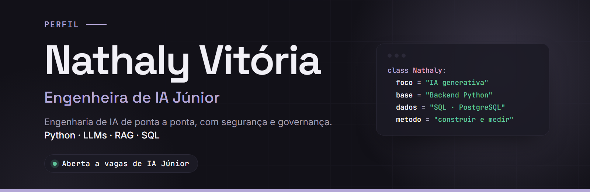

  

  
  
  

---

## Sobre

Engenheira de IA júnior com foco em **IA generativa de ponta a ponta** (LLMs, RAG e agentes), construída sobre uma base de **backend em Python e SQL**. Trabalho com segurança e de forma governada, e busco minha primeira posição como Engenheira de IA Júnior, em vagas **remotas ou híbridas**.

Formação: graduação em Análise e Desenvolvimento de Sistemas e duas pós-graduações, em **IA e Machine Learning** e em **Desenvolvimento Web Full Stack**.

---

## Projetos

| Projeto | O que é | Status |
| :------ | :------ | :----- |
| **Bússola** | Central pessoal de rotina, foco e progresso, instalável como app no PC e no celular, com dados sincronizados. Next.js, TypeScript e Supabase. | Em desenvolvimento |
| [**Portfólio**](https://portfolio-nathaly-omega.vercel.app) | Site bilíngue (PT/EN), com modo claro e escuro, projetos e currículo. Next.js e TypeScript. | Publicado |
| **Menu Go** | Sistema de gestão de restaurante, feito aprendendo Python. | Concluído |
| **Learning Journal** | Notas técnicas e documentação de estudos. | Contínuo |

Os demais projetos, com problema, solução e stack, ficam no [portfólio](https://portfolio-nathaly-omega.vercel.app).

---

## Stack

**Em uso**

  

**Em formação até dez/2026**

`FastAPI` · `RAG` · `embeddings` · `pgvector` · `LangChain` · `MCP` · `Agentes` · `Avaliação de LLMs` · `Docker` · `GitHub Actions` · `pandas`

**Fundamentos da pós-graduação**

`scikit-learn` · `PyTorch`

---

## Formação

| Curso | Instituição | Período |
| :---- | :---------- | :------ |
| Pós-graduação em Inteligência Artificial e Machine Learning | Anhanguera | 2024 · 10 meses |
| Pós-graduação em Desenvolvimento Web Full Stack | Anhanguera | 2024 · 10 meses |
| Tecnologia em Análise e Desenvolvimento de Sistemas | UNIP | out 2021 – jan 2023 |

---

## Contato

- Portfólio: [portfolio-nathaly-omega.vercel.app](https://portfolio-nathaly-omega.vercel.app)
- LinkedIn: [linkedin.com/in/nathaly-vitoria-dev](https://www.linkedin.com/in/nathaly-vitoria-dev/)
- E-mail: [nathalydc2023@gmail.com](mailto:nathalydc2023@gmail.com)
- Local: Guareí, SP · Brasil, aberta a vagas remotas ou híbridas
- Idiomas: português (nativo), inglês (técnico), espanhol (técnico)

  

